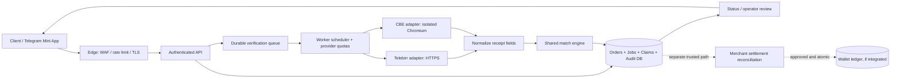

# Ethiopian Payment Receipt Verification — Master Plan & Independent Rebuild Brief

**Document version:** 1.0 · **As of:** 18 November 2026 · **Status:** Architecture and validation plan, **not** a production-readiness certificate

**Audience:** A software engineer or an independent AI development agent asked to reproduce, audit, improve, or replace the existing proof of concept (POC).

> **Non-negotiable safety boundary:** A successful receipt-field match is **not** independent confirmation that funds settled into a merchant-controlled account, nor authorization for a wallet credit, payout, service delivery, or withdrawal. No implementation may silently promote `MATCH` into `PAID` or `CREDITED`.

## 0. Instructions for any new AI agent

This brief describes **the desired behavior and verifiable evidence**, not a mandatory reimplementation of the current code. Start with a source-level audit and a threat model. You may propose a better technical approach if you preserve or strengthen all hard requirements. **Do not claim that anything is measured or deployed unless you have evidence.** Do not make a fresh transfer, perform intrusive provider probing, bypass authentication, or load-test third-party bank systems without explicit authorization.

Deliverables expected from the agent:

1. **Audit report:** reproduction steps; source inventory; security and correctness findings, each marked **verified / inferred / proposed / not tested**; prioritized risks.
2. **Architecture decision record (ADR):** compare retaining current provider adapters against alternate retrieval methods (and how to obtain provider permission); show measurable selection criteria and fallback plan.
3. **Executable implementation:** provider-independent core, two provider adapters, typed API, persistent job queue, worker(s), transaction claims, audit trail, observability, and operator review; preserve CLI compatibility if feasible.
4. **Tests and evidence:** offline fixtures, negative/fraud tests, crash/restart fault injection, idempotency and concurrent-claim tests, load tests against **local mocks**, and low-volume authorized live smoke tests.
5. **Runbook:** environment setup, secrets, backup/restore, outage handling, provider circuit-breakers, manual-review procedure, deployment, rollback, and incident response.
6. **Benchmark report:** actual p50/p95/p99, throughput, resource use, failure/retry rates, queue wait, and comparison with the initial hypotheses; include exact hardware/configuration and sample sizes.

**Definition of success:** The system can retrieve provider-generated receipt information for supported same-provider transfers, reliably compare it to a server-controlled order, reject or defer uncertain cases, recover unfinished work without double-claiming, and survive reasonable abuse at a benchmarked capacity. **Settlement assurance remains a separately sourced requirement.**

## 1. Scope, motivation and terminology

Build a **reusable Ethiopian receipt-to-order matching service** that can later integrate with a Telegram Bingo deposit workflow or other applications without coupling core verification to Telegram. The POC supports:

- **Telebirr → Telebirr** transfers.
- **Commercial Bank of Ethiopia (CBE) → CBE** direct account-to-account (**A2A**) transfers.
- Order-specific references: **Telebirr Customer Note** and **CBE Reason / Type of service**.
- Customer-submitted provider receipt **locator** (official URL, or a Telebirr transaction ID; SMS can contain locators, but SMS itself is untrusted).
- Matching provider, status, transaction identifier, amount, recipient name, recipient account last four digits, reference, and optional transaction-time window.
- Local, provider-scoped duplicate-transaction and order-claim protection.

**Out of scope for the current POC:** cross-provider transfers, transfers not represented in accepted receipt formats, a settlement/merchant banking API, automated wallet credits or withdrawals, bank reconciliation, reversals/refunds, and production service-level guarantees. These need explicit projects or provider agreements.

**Terms:**

- **Receipt field match:** the fetched receipt claims details consistent with one expected order.
- **Claim:** a local anti-reuse reservation of a transaction ID, not proof of settlement.
- **Settlement confirmed:** merchant-originated evidence of actual incoming funds (authorized bank/merchant account feed, statement or verified reconciliation), correlated to the order.
- **Unverified:** missing information, provider outage, ambiguity, unexpected format, unavailable timestamp, or inconclusive security checks.
- **Mismatched:** a verified fetched receipt contains fields incompatible with the particular order; this says nothing about whether a bank transfer exists.

## 2. Proven baseline and evidence ledger

### 2.1 Current implementation — verified by inspecting the attached code

**Artifact:** `unified-payment-cli-v0.1.3.zip` / extracted `unified-payment-cli-v0.1.3/`. TypeScript on Node >=22.13; Node's built-in SQLite (`node:sqlite`) and Playwright (`^1.58.0`). Main entry `verify.ts`; core `src/core.ts`; original Telebirr v5 logic preserved in `src/telebirr-v5.ts`; tests in `tests/`.

- **Telebirr retrieval:** HTTPS `fetch` against `transactioninfo.ethiotelecom.et/receipt/<ID>`, 15-second abort timeout, redirects rejected, response size capped at 2 MB. Extraction uses original `telebirr-poc-v5` functions for live receipts, including the three-column invoice layout. The separately maintained optional timestamp extraction can still fail/return missing.
- **CBE retrieval:** Playwright Chromium opens an official `mbreciept.cbe.com.et/v2-<token>` URL, waits for receipt text and obtains rendered HTML. Navigation timeout 30 s, two 20 s element waits, content length cap 2 MB **after rendering**. A failed HTTP response is `UNABLE_TO_VERIFY`.
- **Order validation:** immutable expectations supplied in an order JSON *for CLI use*; fields are merchant ID, order ID, provider, positive ETB amount, recipient name, 4-digit account suffix, and reference matching an 8–64-character token with letters and digits (hyphen/underscore allowed). Optional created/expiry ISO times must include offset/time zone.
- **Matching:** values are checked and reported as `PASS`, `FAIL`, or `MISSING`. Amount is checked to cents. CBE must be A2A; status must indicate completion. Receipt time only checked if order boundaries are supplied. Any `FAIL` → `MISMATCH`; any missing required field without failures → `UNABLE_TO_VERIFY`; otherwise `MATCH`.
- **Local claim protection:** `claims.sqlite`, WAL mode, 5 s busy timeout, `BEGIN IMMEDIATE` transaction. Unique `(provider, transaction_id)` and `(merchant_id, order_id)` constraints. The CLI only invokes claim after a match and when not in dry-run mode. A directly invoked `claim()` function does **not** independently re-run all verification guards: future API layers must not expose it unchecked.
- **CLI outcomes:** `MATCH`, `MISMATCH`, `ALREADY_USED`, `ORDER_ALREADY_CLAIMED`, `UNABLE_TO_VERIFY`. `--dry-run` creates **no claim**. Locally saved HTML can be manipulated and must be treated as diagnostic only.
- **No server mode, persistent jobs, automatic retry schedule, API authentication, public rate limit, queue, browser worker pool or settlement check** currently implemented.

### 2.2 Test observations — reported in this conversation

| Evidence | Observed result | Qualification |
|---|---|---|
| v0.1.3 unit/integration suite | **11 passed, 0 failed**, including cross-process SQLite claim race | Local simulated tests, not a real-bank latency or stress benchmark |
| v0.1.3 live Telebirr | `MATCH` for a real 10 ETB Telebirr receipt (identifier redacted); all checks `PASS`, including account suffix and exact note | User ran on Windows with `--dry-run --json`; no DB claim and no merchant settlement proof |
| CBE saved receipt extraction | 230 ETB CBE receipt correctly parsed (transaction identifier redacted); intentionally different test order `MISMATCH` | User-provided saved HTML; no settlement proof |
| Historical live CBE | `MATCH` for a historical 120,000 ETB CBE receipt (identifier redacted); all eight checks `PASS`, including recipient/account/note, A2A | **Separate historical diagnostic helper**, old free-form note, `claimed=false`, not an end-to-end production CLI test |
| CBE transient errors | Browser content timeout and HTTP **502** occurred before subsequent successful attempt | Demonstrates temporary external availability risk, not a payment failure |
| Automated throughput/availability | **No live representative performance study completed** | Do not invent average times, capacity, or SLA |

The historical CBE checker (`historical-cbe-check.ts`) intentionally bypasses the *reference token format requirement only* to compare an old customer-entered note. **Never merge this bypass into the production verification path.** It makes no claims.

### 2.3 Constraints and unresolved questions

- Provider HTML and route behavior can change without notice; selectors and parser labels need contract tests and failure alerts.
- Reused public receipt URLs can display true transactions that **did not pay the merchant**. Matching is necessary but insufficient for a financial decision.
- Provider receipts may be delayed or unavailable, with 502 responses or timeouts. How long are receipts retrievable? Are there permitted rate limits or contractual terms? **Unknown**.
- Telebirr optional timestamp parser is separate from v5 core. Time-window matching is not fully live-validated.
- One machine + one SQLite file can support a POC but is not a multi-node HA design.
- **Production-style CBE test** using a reference generated before the transfer and accepted by the normal CLI remains pending.
- No measured latency mean, p95 or safe concurrency for either provider.

## 3. Architecture to implement — reference approach, not a mandated stack

**Recommended v1 deployment:** a modular TypeScript service (for example Fastify), **one deployment host**, an API process and separate bounded worker process, a **durable DB**, and an optional small reverse proxy. Keep provider plugins behind an interface. Start with a simple architecture but retain the option to move worker and data tiers independently. An alternative agent may choose another stack and must justify it against the test criteria.

**Database choice:** SQLite is sufficient to preserve the CLI POC and local tests. For a production-facing queue with multiple app processes, backups, future horizontal workers, and financial workflows, prefer PostgreSQL or demonstrate with fault-injection why SQLite is sufficient. If using PostgreSQL, use durable transactional job claims (`FOR UPDATE SKIP LOCKED` or a proven queue library) and retain explicit uniqueness constraints.

**Provider adapter contract (illustrative):** `fetchAndParse(locator, boundedContext) -> Result<NormalizedReceipt, ProviderError>`. All adapters return normalized IDs, status, amount in **integer cents**, receiver details, note, transaction time with explicitly resolved Ethiopia UTC+03:00 when appropriate, provider, retrieval provenance, and an evidence trace. Do not let parser exceptions become `MATCH`. Use `ProviderError` typed as transient, permanent-input-invalid, parser-drift, security-blocked, or indeterminate.

**Separate responsibilities:** `OrderRepository` (server-trusted expectations), `ReceiptLocatorValidator`, `ProviderAdapter`, `MatchEngine` (pure deterministic), `ClaimsRepository` (transactional), `JobScheduler`, `AuditLogger`, `SettlementReconciler` (future provider-approved), `WalletLedger` (separate authorized financial workflow), `AdminReview`.

### 3.1 Example persistent entities

- **Order:** `order_id`, `merchant_id`, `customer_id`, `provider`, amount minor units, recipient ID/name/account suffix, **server-generated reference**, created/expiry timestamps, lifecycle status; **do not accept these values from an untrusted verification request**.
- **VerificationJob:** `job_id`, `order_id`, `receipt_locator` (encrypted/redacted), provider, requester ID, idempotency key, attempt count, next run, lease owner and lease expiry, last error class, state, created/updated times.
- **VerificationAttempt:** job ID, attempt ordinal, started/finished, provider HTTP/browser timings, parser version, normalized field-check result, evidence hash/fingerprint, redacted errors.
- **TransactionClaim:** provider + normalized transaction ID unique, merchant + order unique, matching job ID, immutable creation metadata; separate from bank settlement.
- **SettlementRecord:** authorized source identity, bank-side transaction reference, amount, merchant account, verified timestamp, reconciliation status; can be absent.
- **WalletLedgerEntry:** source settlement ID unique, wallet ID, amount, credit/debit type, atomic posting transaction, reverse entry model. **No wallet changes in receipt-match transaction alone.**
- **AuditEvent:** actor, action, object, timestamp, correlation ID, outcome, minimal non-secret metadata, integrity/retention policy.

### 3.2 API sketch and permissions

- `POST /v1/orders/{orderId}/receipt-verifications`: authenticated customer submits only provider-specific locator and a client-generated **Idempotency-Key**; server loads trusted order, checks ownership/merchant scope, and records a job. Typically return **202 Accepted** with `jobId` and status URL, not a long synchronous browser wait.
- `GET /v1/receipt-verifications/{jobId}`: scoped authenticated caller sees pending/processing/matched/mismatched/needs-review and safe field-check summary; avoid exposing third-party PII or private full URLs.
- `GET /health/live`, `GET /health/ready`, and authenticated operator metrics.
- Admin-only: list review cases, documented override reason, append-only decision audit, guarded retry/cancel. **Staff cannot forge a settlement record by editing a match result.**
- Future **trusted internal** reconciliation/settlement endpoint: separate service-to-service authentication; never publicly exposed as a wallet-credit shortcut.

**Status model:** Keep receipt-verification and payment/settlement states distinct. Suggested verification states: `SUBMITTED`, `QUEUED`, `RUNNING`, `RETRY_WAIT`, `MATCHED_RECEIPT_ONLY`, `MISMATCHED`, `UNABLE_TO_VERIFY`, `NEEDS_REVIEW`, `EXPIRED`, `CANCELLED`. Suggested payment states: `UNCONFIRMED`, `SETTLEMENT_CONFIRMED`, `CREDITED`, `REVERSED`. A bank 502 **never** becomes a final `MISMATCHED` or `SETTLEMENT_CONFIRMED` state.

## 4. Security and anti-fraud requirements

### 4.1 Financial abuse and receipt forgery/reuse

1. Generate a **cryptographically unpredictable**, order-specific reference on the server **before** any payment; validate that the provider preserves it in the intended field. Customer-entered text may be mistyped: handle via review, not silent reference substitution.
2. Never trust client-supplied expected amount, recipient, merchant account, date window, claim status, or user identity. Compare against server-persisted immutable order data.
3. Restrict to same-provider transactions and CBE A2A for v1; reject ambiguous or incomplete receipt fields **fail closed**.
4. Require normalized transaction ID, final success status, exact transferred amount **excluding fees**, expected recipient, bank-account last four, exact reference, and allowed payment date window. Normalize names carefully; avoid fuzzy matches that enable the wrong payee.
5. Enforce unique provider transaction claim and merchant/order claim in a **single DB transaction**, under concurrency, with traceable outcomes. Deduplication is global within a deployment, not per worker.
6. Authenticate the actual receipt data retrieval on official provider endpoints where supported; treat HTML, SMS, screenshots and locally uploaded files as **untrusted data**. Rendered receipt pages are evidence of provider display, not merchant-side settlement.
7. Flag repeated rejected attempts, recycled IDs, inconsistent amounts, references, unusually many distinct locators per order, and multiple customers submitting the same ID; offer manual review without auto-pay.
8. Consider refunds, reversals, delayed posting and account ownership; implement independent settlement/reconciliation before wallet crediting.
9. Keep the **historical diagnostic checker isolated**: no production endpoint, no claim writing, and no auto-credit.

### 4.2 API abuse, bots and DoS/DDoS

- Authentication and authorization for every order/job; verify Telegram Mini App launch-data signature/server-side if integrated, not just an untrusted username or `initDataUnsafe` object. Staff/merchant/admin scopes and 2FA where suitable.
- Defend against IDOR/BOLA: every query must filter by authenticated merchant and customer. APIs never use arbitrary `merchantId` as access proof.
- Reverse proxy + TLS, WAF/DDoS mitigation if public, bounded request-body sizes and HTTP timeouts. Recognize that edge filtering cannot eliminate all floods.
- Rate limit **per account, IP, merchant, order and provider**, with global quotas on expensive fetch/browser work. Do not assume IP-only throttles stop rotating bots.
- Queue is **bounded**: enqueue with quotas, deduplicate repeated locators and idempotency keys, return `429`/`Retry-After` or safe `503` when saturated; no unbounded memory or disk growth.
- Start with **hypothesis only**: Telebirr 5–10 simultaneous HTTP fetches and CBE 1–2 Chromium browser jobs on a modest host. Must benchmark and reduce or raise based on both local resources and **provider-permitted** traffic.
- Circuit breakers per provider: repeated 502/timeouts open the circuit temporarily, preserve accepted jobs and back off; don't spray retry storms at bank endpoints.
- Bot detection uses observable behavior; CAPTCHA or challenges only when appropriate and accessible, never as sole security boundary.
- Log correlation IDs, rate-limit hits, queue depth, browser crashes, provider errors and anomaly counts with PII minimization.

### 4.3 SSRF and browser sandbox

- Accept **provider-specific identifiers/tokens** where possible and construct trusted URLs server-side. If a full URL is accepted, validate exact scheme (`https`), hostname, path, no userinfo, unexpected port, query, hash, or extra ambiguous links.
- Do not rely only on an initial URL allowlist. Block redirects, DNS rebinding and internal, loopback, link-local, metadata, and private-address destinations via network-layer **egress policy**; permit only required official provider destinations and approved content origins.
- Chromium is untrusted-content execution: run as unprivileged user in a confined container/process, with resource/time limits, no DB or cloud credentials, restricted filesystem, network and downloaded files, and appropriate sandboxing. Deny access to internal services from **all subrequests**, not only the top-level navigation.
- Apply safe HTML parsing, strict size limits to network responses, no arbitrary JavaScript from receipt fields, and sanitize logs and error responses.
- TLS certificate validation on; no `ignoreHTTPSErrors` or disabling browser sandbox in production without a controlled, documented exception.

### 4.4 Data protection and operations

- Encrypt in transit, protect secrets in environment/secret store, rotate keys, least privilege, and do not publish real receipt URLs or sensitive financial data in GitHub, logs or benchmark data.
- Store minimal evidence (masked identifiers/hash where possible); define retention and deletion policy for receipt details and logs in consultation with applicable local law/provider terms.
- Supply dependency scanning, reproducible locks, code review, secret scanning, pinned browser dependencies, and patching.
- Threat model and review with [OWASP API Security Top 10](https://api-security.owasp.org/editions/2023/en/0x11-t10/) and [OWASP ASVS 5.0](https://asvs.owasp.org/). These are **external reference standards**, not claims that this POC complies.

## 5. Reliability, availability, and disaster recovery

### 5.1 Failure semantics — essential contract

| Failure scenario | Required behavior | Recovery path |
|---|---|---|
| No network / DNS / connection reset | `UNABLE_TO_VERIFY` / `RETRY_WAIT`, **not** `MISMATCH` or `PAID` | Persist job and retry with jitter |
| Provider HTTP 502 / 503 / slow page | Circuit-breaker candidate, pending request retained | Bounded exponential backoff, capped attempts, eventual review |
| CBE Chromium crash / timeout | Close/kill browser, release permit, no claim, classify retryable/indeterminate | Fresh isolated context next attempt |
| Receipt HTML format drift | Fail closed; no invented values | Alert parser owner, capture redacted evidence, update fixture/tests |
| API crashes after accepting job | Request remains in DB | Worker resumes after restart; idempotent API replay returns same job |
| Worker crashes during verification | Job lease expires, no final false success | Another worker reclaims job safely |
| Crash between `MATCH` and claim | Persist result/claim using atomic transaction; no ambiguous duplicate | Reconcile state on restart, replay under uniqueness constraints |
| Crash after claim but before HTTP reply | Client may retry with same idempotency key | Return existing outcome, never duplicate claim |
| Duplicate receipt submitted by two accounts | Single unique claim wins | Return safe already-used state and audit fraud signal |
| Database temporarily unavailable | Fail closed; no in-memory-only authoritative claims | Queue admission can refuse safely; resume after DB restored |
| Complete host/disk loss | Only backup/replica can restore durable state | Restore tested backups; reconcile any uncertain financial state |
| Settlement unavailable | Receipt may still match, but **not** credit | Await trusted reconciliation or staff review |

### 5.2 Job handling design

- Persist order and job **transactionally before** returning acceptance. Worker fetch is asynchronous.
- Use durable job lease/visibility timeout and crash-safe state transitions; increment attempt counters and write retry schedules atomically.
- Retry only *transient* problems (timeouts, 5xx, network). Don't retry invalid input or definitively mismatched receipts forever. Parser drift or doubtful provenance → review.
- Exponential backoff with jitter; for initial discussion use **10 s, 30 s, 2 min, 5 min**, then slower bounded schedule/manual review. **These are defaults to test**, not provider-approved frequencies.
- On restart, recover leased-but-expired jobs; ensure each logical job has at-least-once execution but **effectively-once claims** through transactional uniqueness and idempotency.
- Never store payment credentials with the worker. Keep settlement and ledger write path separate.
- A stale user request must not cause a second payment attempt; the verifier only checks a prior payment receipt.
- Retain error classification, next retry time and safe customer message (e.g. "Payment receipt verification delayed; do not pay again").

### 5.3 Availability targets and durability — proposals, not promises

- **Core correctness goal:** no false wallet credits from receipt-only matching; no duplicate wallet ledger entry for the same trusted settlement event. Enforce by architecture and tests.
- Initial availability objective could be **99.5% monthly API availability**, excluding third-party receipt-provider ability to render receipts; define error budget before production. This is an **aspirational SLO**, not a tested achievement.
- Suggested recovery objectives for design discussion: **RPO <=15 min** for nonfinancial job/status data and **RTO <=60 min** for single-host restore, subject to measured backup/restore drills. Financial ledgers require tighter RPO or a more durable transactional platform; no unverified data-loss promise.
- Daily plus more frequent incremental backups as appropriate, off-host encrypted storage, verified restore drills, checksummed migration and durable audit retention. Prefer DB mechanisms with proven point-in-time recovery for production finance-related states.
- Define operational alerts: queue age, p95 verification latency, retry volume, 5xx rate, browser exits, DB errors, disk growth, security alerts, and settlement backlog.

## 6. Performance, concurrency and benchmark plan

### 6.1 Current facts versus hypotheses

**Not measured:** mean/p50/p95/p99 real receipt verification time, real throughput, CBE memory per browser, rate limits, safe concurrency, queue behavior, availability rate.

**Historical planning guesses only (DO NOT present as measurements):**

| Provider | Hypothetical single verification time | Provisional concurrency for a ~2 vCPU / 4 GB host | Why |
|---|---|---|---|
| Telebirr | **1–5 seconds** | **5–10 HTTP requests** | HTML fetch without browser; network/provider dominates |
| CBE | **5–20 seconds** | **1–2 Chromium jobs** | Browser startup/rendering and resource overhead |

The 11 POC tests took about **426 ms total** in the user's Windows run, but those tests do **not** measure live banking latency. A 502/timeout can exceed ordinary successful latency. Theoretical throughput `concurrency / average_service_time` ignores latency tails, provider quotas and failures; never use it as an SLA.

### 6.2 Safe benchmark methodology

**Do not load-test the real bank endpoints.** Use local deterministic mock servers and saved **synthetic** equivalent HTML for concurrency/stress. Do live provider requests only at low, explicitly authorized volume for correctness and a small real-latency sample.

1. **Define resources:** OS, Node/browser versions, CPU count, RAM, disk type, region/network, DB, TLS/proxy, worker/browser launch strategy, per-provider permits, browser process footprint.
2. **Instrument stages:** queue wait, DNS/TLS/connect, HTTP fetch, browser startup, navigation, DOM wait, parse, compare, claim, DB commit, response, memory peak, CPU saturation, provider status and retries.
3. **Warm/cold cases:** test cold browser start versus reused browser with isolated per-job context; don't reuse authenticated state across tenants.
4. **Repeatable synthetic provider profiles:** success (fast), fixed 1/5/10/20 s latency, 502 bursts, long hangs, random reset, malformed HTML, pages missing labels, unexpected redirect, oversized response and blocked internal URL.
5. **Concurrency experiments:** 1, 2, 5, 10, 20 and higher *locally* if resources permit; separately test Telebirr and CBE. Compare queue enabled versus unsafe unlimited concurrency to quantify impact, without touching real providers.
6. **Mixed load:** 80% Telebirr / 20% CBE **illustrative only**; test other realistic traffic ratios. Include bursty Bingo-game traffic (e.g. many simultaneous deposits after a session opens).
7. **Durations/sample sizes:** sustained tests with enough samples for p95/p99 and repeated runs, record sample counts and confidence intervals. Report completed/min, admitted/min, timeout/error/retry rate and queue backlog.
8. **Contention/restart:** 100 or 1,000 synthetic clients targeting one receipt/order and many independent orders; crash worker/API/DB during races and verify state after restart. Synthetic-only traffic.
9. **Abuse simulations:** authenticated scripted flood and malformed inputs against local staging; demonstrate 429/queue/backpressure, memory ceilings, isolation and no false claims. No unauthorized attacks on banks or public systems.
10. **Low-volume provider smoke test:** if permitted, record several successful and failing live lookups at a modest frequency; do not conflate a handful of samples with stable population averages.

### 6.3 Report schema and release thresholds

For each run capture `test_id`, timestamp, code SHA, hardware, concurrency, duration, provider/mocked, sample N, p50/p95/p99 end-to-end and stage timings, mean, successes, retries, 429s, errors by class, memory RSS/peak, CPU, DB wait, browser launches, active worker permits, queue oldest age, and any test interruption.

**Proposed acceptance checks** (numeric SLO thresholds to calibrate after baseline, not guaranteed):

- No mixed-up orders, no double claim, no duplicate ledger posting in fault/concurrency tests.
- At specified queue caps, no unbounded RAM/process growth and no unbounded backlog admission.
- Forced provider 502 or timeout yields **pending/retry/review**, never automatic `MATCH` or `CREDITED`.
- p95 queue wait and service latency measured and reported separately; choose an SLO according to actual product UX and provider constraints.
- During an induced crash/restart, all acknowledged jobs can be reconciled to a durable state; leases recover; claims remain unique.
- Security negative tests for URL allowlist/redirects, browser egress, oversized responses, identity and order ownership, and rate limiting pass.

## 7. Alternative technical approaches for independent evaluation

Independent agents should avoid merely rewriting an HTML parser without comparing the cost and correctness of these options:

| Option | Description | Advantage | Main uncertainty / risk | Decision rule |
|---|---|---|---|---|
| **A — Keep current adapters** | Telebirr HTTPS fetch with v5 parser; CBE Playwright rendering | Already live field-matched; simplest reference baseline | Browser overhead; markup drift; site availability | **Default baseline** until demonstrably improved |
| **B — Authorized structured data/API** | Use official supported payment/receipt or merchant confirmation interfaces if accessible through agreement | Stronger structured data and potential settlement assurances | Access/contract/API availability and costs **unknown** | Prefer for production if legally available, documented and tested |
| **C — Authorized CBE JSON network response** | Investigate what browser requests to render the page; use only if provider permits stable direct retrieval | Could remove browser cost | Undocumented internal endpoint may change or prohibit automation; not proven | Experimental research; do not use in production without permission/support |
| **D — Optimized browser worker** | Reuse Chromium process with isolated per-job contexts/pages and strict lifecycle/egress | Potential CBE latency and RAM improvement | Cross-job leakage and sandbox/cleanup complexity | Benchmark against A with hard isolation tests |
| **E — Uploaded screenshot/PDF/SMS parsing** | OCR or user-provided artifacts | May help manual review | Editable/spoofable; poor source authenticity | **Never** auto-authorize; manual triage only |
| **F — Independent bank statement reconciliation** | Trusted merchant-owned statement/API/feed compared to receipts | Addresses actual settlement | Access, latency, integration, compliance | Mandatory before any automatic value issuance |

**Evaluation scorecard:** correctness/fail-closed behavior (25%), settlement provenance and fraud resistance (25%), operational reliability (20%), latency/throughput (15%), maintainability and provider compliance (10%), infrastructure cost (5%). These weights are suggested; document changes. A fast but unsafe solution cannot pass security gates regardless of score.

For each alternative, provide code/test artifacts, provider permission status, benchmark on identical fixtures/hardware, security review, and a rollback. Do **not** replace known-good v5 parsing merely because a more generic parser looks cleaner.

## 8. Roadmap with gates

### Phase 0 — Reproducible baseline and gap audit

- Pin v0.1.3 and historical helper as immutable reference artifacts, record hashes.
- Run 11-test suite on target Windows/Linux Node; reproduce original Telebirr v5 mock invoice layout and CBE mock receipt, no private uploaded receipts in release package.
- Add regression tests capturing live-output **shapes** with redacted/fake values, and negative cases from previous parser regressions.
- Confirm scope and provider access terms before integrating live services.

**Exit:** evidence-based audit, reproducible tests, prioritized risk list, and explicit unsupported-feature list.

### Phase 1 — Pure domain model and secure adapters

- Extract shared order schema, result/check types, deterministic comparison, and amount-in-minor-units logic.
- Enforce server-controlled order values, secure reference lifecycle, timestamp policy, normalization and fail-closed missing-field semantics.
- Harden URLs, egress, redirects, browser isolation, parsing-size limits, parser-drift/error classes, telemetry and regression fixtures.
- Keep historical checker separate and non-crediting.

**Exit:** full negative/fraud suite passes; adapter contracts independent of API and wallet.

### Phase 2 — Persistent recovery and idempotent jobs

- Create durable job states, leases, bounded retry policy, per-provider circuit breakers, restart recovery and immutable audit.
- Prove atomic claims under concurrent workers; test crashes at each step, including after commit before reply.
- DB backup/restore and migration/reconciliation drills.

**Exit:** no acknowledged job disappears under induced recoverable failures; no duplicate claim; no error becomes confirmed payment.

### Phase 3 — Protected REST API and manual-review workflow

- Implement authenticated asynchronous API, idempotency keys, per-user/order/merchant access control, rate limiting and queue admission, safe outputs and operator review.
- Deploy single-host API + worker + DB behind TLS and controlled egress, with logs/metrics/alerts and secrets management.
- Integrate Telegram Bingo only as an authenticated client; never let a Telegram callback directly post a wallet credit from receipt matching.

**Exit:** API integration tests, OWASP-aligned checks and abuse-load tests pass.

### Phase 4 — Capacity benchmark and controlled pilot

- Local mock stress/fault matrix and independent benchmark comparisons; decide actual concurrency caps based on p95/CPU/memory and provider traffic rules.
- Small authorized provider smoke tests; reproduce production-style CBE unique pre-issued reference.
- Document SLOs, operations guide and rollback before pilot.

**Exit:** measured capacity report, documented limits and successful test drills, without relying on guessed averages.

### Phase 5 — Settlement-backed financial automation (separate approval gate)

- Obtain authorized bank/merchant-side settlement evidence; reconcile transaction ID, merchant destination, amount, time and reversal status.
- Build strict double-entry or equivalent auditable wallet ledger, settlement-event idempotency, refund/reversal handling and staff controls.
- Only after independent financial/security review enable any auto-credit path. Until then: **receipt match → review/pending, not wallet credit**.

## 9. Test matrix: minimum expected cases

| ID | Scenario | Expected result |
|---|---|---|
| C01 | Valid synthetic Telebirr v5 three-column table | All fields correctly extracted; matching order `MATCH` |
| C02 | Valid synthetic CBE rendered A2A receipt | All required fields correctly extracted; matching order `MATCH` |
| C03 | Different amount / receiving account / recipient / note | `MISMATCH`; no claim |
| C04 | Missing amount / status / ID / note or required time | `UNABLE_TO_VERIFY`; no claim |
| C05 | Conflicting Telebirr ID in SMS vs URL | Reject locator; no claim |
| C06 | CBE non-A2A payment | `MISMATCH` or explicit unsupported type; no claim |
| C07 | Same receipt and different orders submitted concurrently | One local claim maximum; others already used |
| C08 | Same order with multiple receipts concurrently | One order claim maximum; others order-claimed |
| C09 | Provider 502/timeout/connection loss | Persist, bounded retry, no final payment approval |
| C10 | Worker crashes mid-fetch, during parsing, after DB commit | Recover without lost acknowledged jobs or duplicate claims |
| C11 | API client retries after response loss with same idempotency key | Same job/outcome; no new financial effect |
| C12 | Unauthenticated or wrong-tenant order lookup | 401/403 or safe not-found; no receipt or PII leak |
| C13 | Malicious URL, redirect, DNS/internal network attempt, oversized HTML | Security rejection; worker confined |
| C14 | 100–1,000 **synthetic** bot requests | Rate limits/queue caps enforce backpressure, no resource exhaustion |
| C15 | Parser label/DOM changes, missing render selector | Parse-drift alert and fail-closed; no `MATCH` |
| C16 | Expired order vs receipt transaction timestamp | Clearly defined policy and fail-closed result; test time zone |
| C17 | Pre-issued production reference preserved in live authorized CBE transfer | Normal CLI end-to-end `MATCH`; no fallback historical bypass |
| C18 | Merchant settlement absent but receipt matches | `MATCHED_RECEIPT_ONLY`, **not** `CREDITED` |
| C19 | Settlement event repeated/reversed | One ledger credit max; reversal compensated by audited entry |
| C20 | DB backup/restore during queue work | Recovered state consistent and audited |

## 10. Deployment, integration and operations

**Initial deployment:** one appropriately sized host with isolated API/worker processes; DB on durable encrypted volume or managed database; HTTPS reverse proxy; logs/metrics; daily backup plus a tested restoration schedule. API should stay responsive when CBE browser pool is saturated. Deployments must drain leases and preserve queue state.

**Scaling path:** isolate CBE worker and reuse safe browser processes if benchmarked; scale Telebirr I/O workers separately; move to a shared DB/queue with cross-node leases and unique transaction constraints; introduce multi-host failover only when justified by measured needs and operational capacity. Scaling app instances does **not** fix a third-party bank outage.

**Client journey:** create order with server reference and recipient details → user transfers money to listed same-provider merchant account → user submits receipt ID/URL → API returns accepted pending job → worker fetches and matches → client sees `pending / matched receipt / mismatch / needs review` → independent settlement workflow confirms merchant funds → only then authorized wallet ledger event, if feature enabled.

**Operational runbooks required:** provider outage (502/timeout), repeated parser failure, claims DB corruption, job queue stall, CPU/memory saturation, DoS/bot incident, compromised account or secret, suspected fake receipt or double claim, settlement discrepancy, backup restore, and rollback to prior adapter version.

## 11. Critical questions that require human decisions

- Is the first deployment exclusively for the Telegram Bingo business, or should multiple merchants integrate? Tenant and authorization models differ.
- What provider approval/terms are available for retrieving Telebirr and CBE public receipt pages, and for any structured/settlement APIs?
- How can a trustworthy confirmation of incoming funds be obtained from each actual merchant collection account? This determines whether financial automation is ever appropriate.
- What traffic is expected (peak deposits per minute, provider mix, busy-hour bursts), and what customer verification waiting time is acceptable?
- Where will it run (VPS CPU/RAM/OS, region, budget, backup storage), and what maximum browser concurrency is allowed?
- Which order window rules are business requirements? If the receipt lacks transaction time, should the case always enter review rather than automatically pass? **Recommended: yes**.
- Who is authorized to approve a manual discrepancy, and can they ever override settlement requirements? **Recommended: no unilateral override of bank settlement proof**.
- Are legally required data-retention, audit, financial-transaction or gambling regulations applicable? Obtain domain-specific review before deployment.

## 12. Final production readiness checklist

- [ ] Complete independent source audit and threat model; risks prioritized and resolved or explicitly accepted.
- [ ] Same-provider, A2A and unique-reference contract enforced by the normal service.
- [ ] Correct/missing/mismatched receipt cases fail closed; live/provider evidence not fabricated.
- [ ] Secure HTTPS/hostname/path validation, egress controls and browser sandbox tested.
- [ ] Authentication, object authorization, tenant scoping and per-provider quotas tested.
- [ ] Durable accepted jobs, leases, retry/backoff, circuit breaker and manual-review path tested.
- [ ] Unique global claims, idempotency and crash/restart race tests passed.
- [ ] Redacted audit logs, monitoring, backups and successful restore exercise available.
- [ ] p50/p95/p99/throughput/memory/CPU benchmarks completed with local mocks and permitted live smoke tests.
- [ ] Production-style CBE unique-reference live test passed through normal, uncompromised flow.
- [ ] Exact capability boundaries disclosed to clients: receipt match ≠ settlement.
- [ ] Trusted merchant settlement source and reconciled ledger **before** any automatic wallet credit.
- [ ] Provider permission, privacy, financial/compliance requirements and incident runbooks reviewed.

## 13. Handoff assets and how to use this plan

Provide the agent **this file** and, if available, these baseline artifacts:

- `unified-payment-cli-v0.1.3.zip` — current working TypeScript POC; contains README, source, synthetic tests and fixtures, **no original customer CBE receipt**.
- `telebirr-poc-v5(1).zip` — independently working original Telebirr extraction implementation; protect its successful parsing behavior.
- `cbe-historical-dryrun-kit.zip` — one-off diagnostic to compare legacy CBE receipt fields; **not** suitable for production payments or claim writing.
- `CBE Receipt Viewer.html` — uploaded historical example for private inspection only; **do not publish it or commit it to a repository**.
- The supplied test outputs: 11/11 Windows tests, Telebirr real `MATCH`, historical CBE real `MATCH`, CBE HTTP 502 then recovery. **The plan deliberately redacts live transaction identifiers.** Redact personally identifying financial details before sharing supplementary source material.

**Recommended first prompt to another agent:**

> You are independently auditing and proposing the next-generation Ethiopian receipt-to-order verification service. Read the attached MASTER PLAN and source ZIPs, inspect rather than assume existing behavior, and preserve all non-negotiable financial boundaries. First produce: (1) a verified-vs-unverified evidence table, (2) top security/correctness risks, (3) a baseline architecture and at least two viable alternative approaches with a decision matrix, (4) implementation phases with exact acceptance tests and fault-injection scenarios, and (5) a safe benchmark protocol using local simulated providers rather than stress-testing live bank systems. Do not start by rewriting code or making new payments. Explicitly distinguish receipt matching, claim deduplication, merchant settlement, and wallet crediting. After the audit, implement Phase 1 and Phase 2 incrementally with runnable tests, and report exactly what passed.

---

**Source basis:** This plan was assembled from the user and assistant's November 2026 technical discussions plus direct inspection of the local v0.1.3 TypeScript source, original Telebirr v5 ZIP, CBE historical helper, and uploaded CBE receipt HTML where relevant. User-reported live command outputs are explicitly labeled as such. Proposed architecture, capacity guesses, SLOs, and future controls are **not already implemented or validated**.
